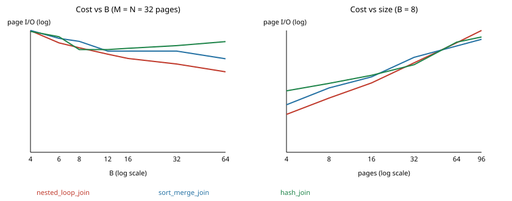

# Module 2 report

All numbers come from `python3 -m experiments.m2_measure --out experiments/results/m2.json --plot docs/m2_crossover.svg`. Tables are (INT, VARCHAR(200)) rows, 19 per page, with random join keys. Measured I/O is page reads plus writes for the whole plan, scans included.

## Joins against the formulas

M = N. Each cell is measured / formula. For sort merge I used the textbook sort(X) = 2X per pass.

| M = N | B | Nested loop | Sort merge | Hash |
|---|---|---|---|---|
| 8 | 4 | 45 / 40 | 82 / 80 | 54 / 48 |
| 8 | 16 | 18 / 16 | 34 / 48 | 78 / 48 |
| 8 | 64 | 18 / 16 | 18 / 48 | 246 / 48 |
| 8 | 256 | 18 / 16 | 18 / 48 | 360 / 48 |
| 32 | 4 | 561 / 544 | 568 / 448 | 528 / 192 |
| 32 | 16 | 132 / 128 | 194 / 320 | 222 / 192 |
| 32 | 64 | 66 / 64 | 130 / 192 | 318 / 192 |
| 32 | 256 | 66 / 64 | 66 / 192 | 856 / 192 |
| 96 | 4 | 4753 / 4704 | 2212 / 1728 | 1679 / 576 |
| 96 | 16 | 776 / 768 | 770 / 960 | 602 / 576 |
| 96 | 64 | 291 / 288 | 578 / 960 | 694 / 576 |
| 96 | 256 | 194 / 192 | 194 / 576 | 1202 / 576 |

Why they differ:

- **Nested loop** is always a little over the formula. Every scan of a table also reads its directory page, and the inner table is scanned once per block.
- **Sort merge** is under the formula when B is large. My last merge pass feeds the join directly and never writes, and when a table fits in memory there are no runs at all, so the cost is just M + N. At B = 4 it is over, because the two sorts have to share 4 frames. Each one can only keep 1 or 2 runs open for the join, so it needs extra merge passes.
- **Hash** is over the formula at both ends. At small B the partitions are bigger than B − 1 pages (96 / 3 = 32 pages at B = 4), so they get split again or fall back to nested loop. At large B I make B − 1 partitions as the spec says, and every partition writes at least one mostly empty page. With 255 partitions for 8 pages of data, that is where the 360 comes from. The formula assumes the partitions are full.

Comparisons: block nested loop reported exactly |R| x |S| in every run (a test checks this).

## Sort passes

| N | B | Formula | Measured |
|---|---|---|---|
| 8 | 3 | 3 | 3 |
| 30 | 4 | 3 | 4 |
| 80 (20 x B) | 4 | 4 | 4 |
| 100 | 8 | 3 | 3 |
| 500 | 16 | 3 | 3 |
| 64 | 64 | 1 | 2 |

The two misses come from my pass 0 runs being B − 1 pages instead of B, because the input page uses a frame. For N = 30, B = 4 that gives 10 runs instead of 8, and 10 runs need one more merge pass than 8 with a fan-in of 3. For N = 64, B = 64 the table needs 2 runs instead of fitting in one.

## Crossover

**Fixed size (M = N = 32), varying B:**

| B | 4 | 6 | 8 | 12 | 16 | 32 | 64 |
|---|---|---|---|---|---|---|---|
| Cheapest | hash | nested loop | hash | nested loop | nested loop | nested loop | nested loop |

From B = 12 on, nested loop wins and keeps winning, because its cost M + ceil(M/(B − 2)) N drops fast as the block grows. At B = 34 the whole outer table fits and it costs only M + N. Hash gets worse as B grows, for the partial page reason above. Below 12 the three are close and the winner flips between B values, depending on how the partitions and runs happen to round.

**Fixed B = 8, varying size:**

| M = N | 4 | 8 | 16 | 32 | 64 | 96 |
|---|---|---|---|---|---|---|
| Cheapest | nested loop | nested loop | nested loop | hash | sort merge | sort merge |

Nested loop grows with M x N, so it loses once the tables pass about 16 pages. Hash wins at 32 pages. At 64 pages it loses to sort merge because the partitions stop fitting: 64 / 7 is about 9 pages, more than the 7 build frames, so they get split again. Hash only stays cheap while M is under about (B − 1)², which is 49 here. Sort merge just adds passes slowly as the size grows.

## Skew

R and S have 1500 rows each (79 pages). In the skewed set, key 0 is in 40 percent of the rows on both sides. Hash join at B = 16:

| Case | Partition sizes (pages) | Overflow handling | Reads | Writes | Rows |
|---|---|---|---|---|---|
| Uniform | 15 partitions of 6 | none | 340 | 180 | 1500 |
| Skewed | 14 of 3 or 4, one of 35 | split at depth 1 and 2, then nested loop | 594 | 322 | 360,900 |

Splitting again could not help, since every row with key 0 hashes to the same place with any seed. After depth 2 the 32 page partition fell back to block nested loop. The skewed join cost 916 I/Os against 520 for the uniform one, about 1.8 times as much, and most of that is the two useless re-splits plus the nested loop over the hot partition.

## The budget

I sorted an 80 page table (20 x B) at B = 4. It finished in 4 passes with 321 reads and 240 writes, and the output was in order. The most frames held at once was 4. I know this because every frame an operator uses, including sort runs and hash tables, is a pinned frame in the one buffer pool. The pool records the highest number pinned at any moment, and it raises an error rather than go past B. Running the same plan twice gave the same counters.
